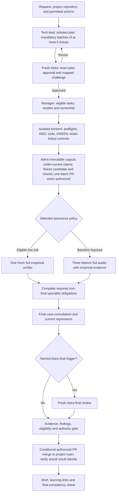

# I2E v2: project fleet, empirical verification and bounded batches

Version: consolidated review proposal v7 · 2026-11-04. Proposed runtime profile remains i2e-team/v2.

Status: **DESIGN_REVIEW_ONLY — NOT INSTALLED — PERFORMANCE UNVERIFIED**.

Proposed future profile: `i2e-team/v2`. This is a review target, not a claim that such a runtime/profile exists. V6 received independent design approval with no remaining findings. User direction U06 introduces three finding severities and task priorities, High-triggered Astra ownership, Sol-led Medium work and deferred Low observations. Severity and priority remain separate fields. The maintainability loop (§11.1), maximum-five-ticket batches, Git/GitHub traceability and preserved safeguards remain. V7 requires its own independent verdict; prior approvals do not approve these changed bytes. Earlier packets/reviews remain preserved; see [review response](REVIEW-RESPONSE.md). This revision does not activate any policy.

## 1. Objective and scope

Build a reusable engineering fleet for each project. The user supplies an outcome; a planning-only tech lead scopes it, one project manager coordinates work, suitable workers implement it, independent verification establishes evidence, and the manager performs only authorized delivery actions and reports the actual result.

Make ordinary work less repetitive through deterministic checks, a proposed single-verifier route for eligible low-risk work, reusable project context and mandatory bounded review batches for decomposed tasks, with at most five ticketed changes in each batch. Preserve acceptance quality, independence, failure history and release boundaries. A simple task need not activate every specialist or multiple workers.

The design combines three changes that must be evaluated separately:

1. Improve verification quality through executed acceptance checks, targeted negative controls and precise source-supported findings.
2. Reduce routine audit sessions only for work that qualifies under a separately selected policy.
3. Share planning/context/check/review setup across a small coherent batch while retaining per-task acceptance evidence.

V7 also proposes filtering incidental Low findings out of routine review output and automatic repair/re-review cycles, with compact deferred observations for later reconsideration (§6). Evaluate this effect separately from reviewer-count, routing and batching changes; no cost reduction is established by changing labels.

Daily latency, reliability and token savings remain unmeasured. The earlier PNG/HTML checks established diagram quality only. This packet is not an implementation request, an installed policy, an exception to current project gates or release authority.

## 2. Source and decision status

This document consolidates the frozen empirical proposal S01, review-policy proposal S02, graph design S03 and batching addendum S04. The preserved baseline is the reviewed `i2e-team/v1` snapshot at commit `a8374b7b299000ac27eed167e78e159b0c84ddd4`, not an assertion about another session's current edits or the current installation.

- **Preserved requirements:** explicit user constraints and baseline safeguards not explicitly proposed for replacement.
- **Proposed changes:** role separation, model routing candidate, eligible single-verifier route, bounded ticket batches, explicit Git/GitHub delivery and executable graph extensions. They require review and eventual policy/runtime adoption.
- **Consolidation clarifications:** details omitted from the overview diagrams are restored, particularly write preflights, finding-recheck independence, final case consultation and final-review ordering.
- **Initial design positions and deferred decisions:** section 15 incorporates the independent review. Conservative initial contracts are explicit; optional relaxations, numerical evaluation thresholds and live adapter capability remain separately gated.

User direction governs. A newer proposal may propose changing an older rule; it does not make that change operational merely by describing it. The frozen empirical reference is unchanged, SHA-256 `5c722c4ac4effd3b7be059d4aced424e5d33aae077f5e32521823e6dd39752fc`.

## 3. Fleet and model assignments

One project manager is the engineering coordinator. A portfolio layer may route between projects, surface dependencies and consolidate reports; it does not run a second engineering loop inside a project. Project knowledge and role definitions persist; workers and reviewers activate when needed. Persistence does not mean keeping every role running continuously or retaining an unbounded transcript.

| Role | Responsibility | Boundary |
|---|---|---|
| User / product owner | Desired outcome, business priority, material tradeoffs and allowed external actions | No human approval or risk acceptance may be invented |
| Tech lead | Read-only investigation; decompose work into bounded tickets and required batches of at most five; plan acceptance, dependencies and risk | Never implements; a separate worker performs production work |
| Project manager | Arrange challenges/approval, assign eligible work, reconcile state, collect evidence and deliver | Cannot approve its own contributions, waive gates or infer new authority |
| Fresh Astra plan reviewer | Challenge assumptions, edge cases and verification adequacy; approve an exact revision | Independent of the plan's authors and contributors |
| Implementation worker(s) | Bounded edits and required focused tests | Owned paths, valid phase/claim and approved scope |
| Deterministic tool nodes | Relevant lint/type/build/test/scan checks, hashing and ledger validation | Tool results have defined coverage limits; code nodes need no LLM session of their own |
| Fresh Sol verifier / baseline auditors | Execute checks, inspect assertions and relevant source, identify material gaps | Independent of all planning, orchestration and implementation contributors to the candidate |
| Required specialists | Security, test, formal or architecture analysis | Selected by evidence and policy; no automatic disappearance when a task is small |
| Fresh Astra final reviewer | Final candidate judgment when a named trigger applies | Excludes contributors and all prior relevant plan/doubt/audit/verification/escalation participants |

The manager owns the challenge process. Its own challenge is useful but does not replace independent exact-plan approval. Preparation may be shared between exact-plan review and explicitly mapped decision challenges, but each decision retains its own identity and verdict; general plan approval cannot close an unresolved architecture question. The lead may reuse its read-only investigation while planning; an extra probe session is not necessary solely to rename that role. That is a proposed v2 packaging change, not a waiver of independent review.

### Requested model configuration

| Model | Requested effort | Requested service tier |
|---|---|---|
| GPT-6 Astra (`gpt-6-astra`) | max | Standard |
| GPT-6.1 Sol (`gpt-6.1-sol`) | max | Fast |
| GPT-6.1 Terra (`gpt-6.1-terra`) | max | Fast |

Luna is excluded. These are desired invocation settings, not verified access or invocation evidence. The dispatcher must record requested settings separately from effective model, reasoning effort, service tier and session/context provenance. Effective settings require host/adapter evidence tied to the actual invocation; prompt labels and model self-reports are insufficient. Capability validation must establish which fields the adapter can attest and which remain unknown. A role prompt cannot change the running model. If a host cannot express the tier split, use a supported separately configured session adapter or hold the affected dispatch; never silently substitute settings.

### Three-level classification and ownership

Use **High / Medium / Low** for finding severity (§6) and, separately, task priority. Severity describes the impact of a defect; priority describes the business urgency of authorized work. Record technical risk and difficulty separately. Critical remains a technical-risk/escalation trigger, not a fourth finding severity. No findings is NOT_APPLICABLE, not an invented Low finding; a genuinely unknown required classification remains UNKNOWN.

Apply the first matching row. High priority **or** a High finding affecting the work is sufficient for Astra ownership; they need not both be High.

| Task or finding condition | Manager | Planning-only tech lead | Implementation / disposition |
|---|---|---|---|
| High task priority, High finding severity, or Critical technical risk | Astra | Astra | Separate Astra worker owns implementation; Sol may take explicitly approved bounded parts |
| Medium priority or Medium finding; no High/Critical trigger | Sol | Sol; Astra challenge for difficult architecture | Separate Sol worker by default; Terra for explicitly planned bounded routine edits |
| Explicitly requested Low-priority work; no higher finding/risk trigger | Sol | Sol with a proportionate plan | Terra for bounded routine edits; Sol otherwise; fulfill the authorized request |
| Incidental Low finding only | No new assignment | No new plan | Record DEFERRED_LOW in existing observations; no automatic ticket, repair or re-review |

Medium preserves the earlier Sol-led plan and Terra role for bounded routine implementation. The exact plan records that choice; uncertainty is not permission to down-route. Low finding suppression never cancels user-requested work. A Low-priority task with a High finding follows the High row. Difficult architecture, repeated-repair escalation and existing mandatory Astra obligations remain in force; difficulty alone does not introduce another automatic router (O1).

Classify before dispatch and reassess when evidence or scope changes. Credible possible material harm needs enough investigation to classify; uncertainty is not Low. Unknown required classification holds dependent dispatch while permitted read-only diagnosis can continue. A changed route requires a current exact-plan revision and approval; it cannot authorize earlier edits or waive prior obligations. Legacy numeric labels remain in historical records: classify new work from intent and evidence, without rewriting old receipts or inferring finding severity from task priority.

These rows select coordination and implementation ownership. They do not replace the independent Sol assurance/recheck roles or determine the seven Astra final-review triggers. Finding severity, task priority and technical-risk eligibility must not be interchanged to obtain reduced assurance. Adoption remains separate from preserving the installed route during baseline runtime groundwork.

## 4. Preserved requirements

- **REQ-01 — Authority and source boundaries:** establish repository/client, owned paths, user objective, instructions and allowed actions; preserve others' edits and existing dirty work. Review approval grants no commit/push/PR/merge/deploy authority by itself. Already granted standing authority remains usable within scope.
- **REQ-02 — Exact plan and decisions:** fresh independent Astra approves the exact plan revision. Preserve rejections; the latest qualifying verdict governs starts. Non-trivial decisions receive an applicable independent challenge before dependent work. A meaningful RED may challenge its mapped ordinary behavioral claim; significant architecture/Critical questions require Astra. Exact-plan review may satisfy a challenge only when it explicitly addresses that decision.
- **REQ-03 — Ordered writes:** preserve VERIFY, TEST_ONLY and PRODUCTION semantics, phase history and real preflight results. A later approval cannot authorize an earlier edit. Inspect preflight state before each dependent action; a BLOCK stops the affected write.
- **REQ-04 — Failure and case obligations:** preserve actual failures before repair and use the existing canonical helper/store. Missing capture/lookup is a gap, not an empty result. Consult before planning, each repair and final acceptance; carry known case digests and applicable regressions regardless of search ranking.
- **REQ-05 — Two separate escalation rules:** two failed repairs of one stable defect require Astra diagnosis before another attempt. Three unresolved substantive challenge cycles of one decision stop dependent work and surface the decision to the user/PM. Expected test-first RED is not a failed repair. Neither threshold is a token budget.
- **REQ-06 — Independence:** actual session identities and contributor history determine eligibility. The independent verifier did not plan, coordinate or implement any included task. Preserve mutually distinct baseline code/security/test auditors when that route applies and fresh Astra final-review exclusions.
- **REQ-07 — Current evidence:** relevant source, instruction, profile, harness, dependency, base or configuration changes invalidate affected evidence/approval. Integration conflict resolution is a source change. Acceptance requires current applicable proof and complete findings disposition.
- **REQ-08 — Honest completion:** UNKNOWN, NOT_RUN, BLOCKED, UNVERIFIED and other precise evidence states remain visible. A completed model turn, passing structural checker or readable diagram is not task acceptance, deployment or customer acceptance.
- **REQ-09 — Learning and usage:** provide an immediate concise engineering brief with actual decisions, rejected alternatives, tradeoffs, proof limits and one reusable principle. Do not invent alternatives or learner mastery. No per-run budget, cost ceiling or budget-approval gate is added; unknown usage is not zero.

## 5. Lifecycle

The graph below is a lifecycle overview; a node can be code, a model invocation or a recorded decision. It does not imply one newly initialized agent per box. Gate tables and source contracts control the detailed behavior.



Failures from checks, verification, specialists or the delivery gate return to a bounded worker repair or to lead replanning, with invalidation and the two escalation rules above. No failure path skips current checks/reviews on re-entry. A prerequisite gap enters HOLD; cancellation and failure remain distinct terminal states.

| Stage | Owner / executor | Required inputs and guard | Output |
|---|---|---|---|
| L0 Intake | Manager + tech lead | Intent, exact project repository/main branch, issue ownership, client, instructions, current worktree, authority and known cases; required routing fields resolved | Parent request and project-bound ticket/batch contract |
| L1 Plan | Tech lead | Ticket-level acceptance, exclusions, dependencies, risk, owned paths, checks and triggers; mandatory batching and maximum-five validation | Immutable plan revision, ticket-to-batch map and verification contract |
| L2 Challenge / approve | Eligible reviewers; fresh Astra approval | Exact revision plus original intent; unresolved architecture decisions remain obligations | Explicit verdict, decision coverage and findings |
| L3 Dispatch | Manager + runtime | Approved revision, completed dependencies, current claim/write scope, confirmed invocation and replacement/isolation contract (§9.1) | Bounded attempt with real actor/session identity and exclusive writable outputs |
| L4 Implement / test | Workers | Applicable VERIFY baseline, authorized TEST_ONLY/PRODUCTION sequence, challenge and case obligations | Per-task source and genuine test/failure evidence |
| L5 Integrate / check | Controlled integration executor + tools | Immutable outputs admitted under current fences/ownership (§9.1); ticket-to-commit map and maximum-five final diff; required checks execute | Frozen batch commit/tree, provenance/check receipts; one batch PR when authorized |
| L6 Independent assurance | One verifier or baseline audits; required specialists | Whole candidate, per-task criteria, context and receipts; eligibility confirmed | Per-task and batch findings, executed/inspected claims, proof limits |
| L7 Final prerequisites / review | Manager, tools, fresh Astra if triggered | Final case consultation and current regressions; all required non-final reviews/dispositions complete | Final approval when required; no trigger silently omitted |
| L8 Accept / deliver | Runtime gate + manager | Current identities, complete findings, required approvals, action authority and operation-enforced preconditions (§9.2) | Technical acceptance and separately reconciled delivery identities/results |
| L9 Report / learn | Manager + ledger | Actual outcome, proof, decisions, limits, any continuation work; observed maintainability patterns and lesson dispositions under §11.1 | Status first, concise brief, evidence/decision links and final consistency result |

Check/append/report order must preserve the baseline's requirement that technical readiness is established before recording completion, then the brief is recorded and final consistency checked. External action status remains separate: `accepted locally`, `PR opened`, `CI passed`, `merged` and `deployed` are not interchangeable.

## 6. Assurance policy

### Eligible low-risk route — proposed change

One fresh independent Sol verifier replaces the three routine Sol audit sessions only when all eligibility conditions hold: bounded scope; assessed Low risk; observable acceptance; adequate relevant regression coverage; reproducible checks; no mandatory specialist requirement; and no unexplained failed or unrun critical check. Assess the combined batch, not merely each task in isolation.

The verifier executes key acceptance and selected failure cases, inspects assertion quality and relevant source/callers/dependencies, considers baseline security concerns and reports remaining limits. It receives original intent, scope and accepted tradeoffs without treating the author's correctness conclusion as evidence.

### Baseline and unresolved intermediate route

Critical work and any mandatory baseline policy retain three mutually distinct independent Sol code/security/test audits. They become more empirical, with current shared suite receipts and targeted independent checks; they are not replaced by a fourth generic verifier plus three audits.

The initial proposed policy uses the baseline three-audit route for Medium/High non-critical technical risk and for unknown reduced-route eligibility. These risk levels are separate from finding severity and task priority. Defer a verifier-plus-selected-specialists intermediate route until evidence supports explicit eligibility rules and the owner selects it (O2). The dispatcher cannot improvise that route. No fourth generic verifier is added to the three baseline audits.

### Triggered obligations

| Obligation | Trigger / purpose | Required result |
|---|---|---|
| Security specialist | Auth, tenants, secrets, sensitive data or trust boundaries | Independent threat/source judgment, relevant scans and safe negative tests |
| Test/verification specialist | Weak assertions, large behavior changes, concurrency/retries, unclear regressions or difficult reproduction | Stronger oracle and failure/integration coverage with limits |
| Formal checking | A justified invariant/progress property where state-space exploration adds value | Model/checker evidence, assumptions/bounds and demonstrated implementation mapping |
| Architecture challenge / diagnosis | Significant architecture/Critical decisions, substantive conflict or repeated failed repair | Evidence-backed analysis of the specific decision/defect |
| Astra final | Any of the seven named triggers below | Fresh final review of the current candidate after other required assurance and final case checks |

A qualifying baseline security or test audit can discharge the corresponding specialist obligation when its contract and evidence cover it. Record that coverage mapping; do not spawn duplicate reviewers solely because two labels describe the same required work. Mandatory distinct baseline roles remain distinct. Non-final specialists may run in parallel on the frozen candidate; final review follows their resolved results.

All seven Astra final triggers must be explicitly assessed: consequential authorization/tenant changes; destructive migrations; critical financial behavior; uncertain cross-system interactions; material redesign; conflicting reviews; user/project requirements. Reassess after actual changes/findings. An unknown trigger blocks the relevant routing/acceptance decision.

### Findings and repair rechecks

Routine review output reports only **High and Medium** findings. Each needs a stable ID, affected requirement/risk, concrete evidence, consequence, smallest sufficient correction and validation. Accept executed reproductions, deterministic checks, precise source arguments and relevant formal counterexamples; unsafe live exploitation is not required. Implementers explain supported disagreements instead of accepting every suggestion automatically. No-findings is a valid result.

| Finding severity | Impact test | Treatment |
|---|---|---|
| High | Serious harm to business logic, an essential workflow, security, data integrity or reliability | Report; Astra ownership under §3; resolve before delivery through the existing disposition/authority rules; preserve emergency escalation |
| Medium | A concrete defect or maintenance problem with material, bounded impact | Report with evidence and the smallest sufficient correction; Sol-led handling under §3 and the existing disposition/recheck rules |
| Low | Optional polish, preference or minor issue with no demonstrated material impact | Omit from routine findings; compact DEFERRED_LOW observation; no automatic work or additional review cycle |

Classify impact before filtering. An apparent nit that can materially break an important workflow is Medium or High when evidence supports that consequence; do not wait for a production incident. Credible but uncertain material risk stays an explicit unresolved classification/assurance gap until assessed, not a suppressed Low. Do not inflate preference-only advice to Medium to bypass the filter.

For each encountered Low finding, use a compact, deduplicated entry in existing observation/decision artifacts: stable ID or deduplication key, source/candidate location, short reason for Low and a concrete revisit trigger. Mark it DEFERRED_LOW, not FIXED or risk-accepted. Link repeated instances to the same pattern. No separate backlog/store, ticket, owner/due-date chase, capture quota, Low-only review or scheduled sweep is introduced. Routine reports may link the observation record without listing its Low entries. Revisit on relevant new evidence, repeated aggregate burden, changed requirements or an explicit user request. If impact becomes material, append a linked reclassification, preserve the old evidence, and apply current routing, planning and assurance before repair; defer optional cleanup unless authorized.

This filter applies to incidental review advice. It cannot hide a required acceptance failure, security obligation, real failure capture, unfinished user request or previously recorded actionable finding. Those retain their required evidence and supported dispositions; changing the label alone cannot close them. An eligible DEFERRED_LOW observation does not block acceptance or require a FIXED-finding recheck. Failed checks remain failures even when a reviewer suggests Low.

The frozen runtime requires a FIXED actionable finding to have current passing recheck proof and an independent Sol recheck reviewer distinct from contributors **and the original finding reviewer**. Preserve this default. The primary verifier may retain context and renew the batch verdict, but that alone does not satisfy the distinct finding-recheck obligation. Clean passes can use one verifier; findings can introduce additional review. Several findings may share one recheck session only if that session independently satisfies every finding’s identity and scope requirements. Measure incremental detection and delay before proposing relaxation (O3); no saving from removing this rule is assumed.

Empty later audits do not erase earlier findings. NOT_APPLICABLE needs a concrete supported disposition; material risk acceptance requires actual user/human authority tied to the finding. Models cannot manufacture that acceptance.

## 7. Empirical and formal verification

### Phase semantics

| Phase | Write scope | What it can establish |
|---|---|---|
| VERIFY | Empty source-write scope | Existing applicable CHECK proof while source/tests/instructions/profile remain unchanged; can collect unrelated regressions while findings stay open |
| TEST_ONLY | Explicit approved test paths within the intake test ceiling | Meaningful behavioral RED on the before-candidate; production bytes remain unchanged |
| PRODUCTION | Approved production paths, excluding the immutable test ceiling | Implement the behavior and obtain GREEN with the RED test identity/bytes unchanged, plus current relevant checks |

VERIFY cannot supply RED/GREEN, complete an open writing cycle, clear a capture/lookup gap or reset phase history. Reopened TEST_ONLY invalidates completion until the subsequent authorized production cycle and current evidence close it. The strict baseline has no behavioral waiver. Nonbehavior work uses actual applicable proof without inventing a RED.

Ordinary writes also require current applicable regression proof and resolved findings/case obligations, except for the exact named obligations of an approved bounded remediation. Authorized test changes can make existing CHECK evidence stale; refresh that evidence before dependent production writes. Preserve the source baseline across restarts and narrower plans so a new phase cannot hide earlier production edits.

Bounded remediation may authorize repair of named obligations before those obligations are fixed. It still requires an approved scoped remediation, capture/consultation, challenge, phase and escalation prerequisites. It cannot become a blanket waiver for unrelated writes. Later approval never cures premature work retrospectively.

### Test and harness evidence

At RED preserve the source snapshot, test bytes, runner, config, relevant fixtures, dependency lockfile, environment/tool versions, exact command, expected result, output and exit code. A syntax/import/fixture/setup failure is not behavioral RED. Relevant harness changes require reassessment; an unchanged assertion file alone is insufficient.

For a regression, demonstrate failure on broken behavior and success after repair. For important new behavior, use targeted negative controls, fault injection or mutation against plausible faults. Focus on critical changed behavior. No unique mutant per new test and no universal 100% mutation target are required. Distinguish genuine assertion failures from invalid/equivalent mutants, compilation failures, setup problems and timeouts. Run temporary mutation/fault experiments on disposable copies with their own identities; they must not alter the frozen acceptance candidate. Reconcile and discard experimental outputs before accepting current proof.

Every receipt states its requirement, source/candidate identity, harness/configuration identity, command, environment, expected/actual outcomes, exit code, executing actor/session and whether the reviewer **executed** or **inspected** it. Preserve raw artifacts; use concise summaries with references in prompts. Hashes identify artifacts, not their correctness or adequacy.

Shared full-suite evidence may be reused for the same applicable frozen candidate and verification setup. A changed candidate requires refreshed affected proof and a current acceptance decision. The initial contract permits same-candidate reuse only where setup and obligations also match; cross-candidate caching is deferred until dependency-impact rules exist (O6). Historical RED and earlier receipts remain immutable provenance, not current acceptance proof. Explicitly distinguish retained history from evidence valid for the present candidate.

### Selective formal checking

The plan names the property, assumptions, bounds, covered implementation and reason formal work is useful. Preserve model/config hashes, checker version/command, termination state, explored bounds, reachability/progress observations and counterexamples. Check that intended transitions remain possible; a disabled behavior can make a safety result misleading.

Demonstrate model-to-code alignment through mapped scenario tests, replayable counterexamples where representable or trace validation. A sync commit is bookkeeping, not proof. Relevant changes require reassessment; record remaining gaps. A bounded model result is not proof of all production executions. Initial formal targets are ownership/replacement, stale approval rejection and ambiguous publication recovery (O9). Include fairness and environment assumptions, reachable success paths and implementation-linked counterexamples. Trace agreement alone is partial evidence. Ordinary UI/CRUD starts with suitable implementation tests unless a specific formal property justifies more.

## 8. Mandatory review batches and Git/GitHub delivery

### 8.1 Batch rule selected by the user

When the tech lead decomposes one request into multiple implementation tickets, it **must** assign those tickets to review batches. Each batch contains **at most five bounded ticketed changes**. Batching is the required workflow for decomposed work, not an optional optimization and not a requirement to collect exactly five tickets. A single-ticket request is a one-ticket batch. A remaining group may contain fewer than five; do not invent unrelated work or wait to fill a quota. Examples: three compatible tickets form one batch; eight compatible tickets can form batches of five and three.

For this cap, one “edit” is one bounded, separately accepted implementation ticket with a stable ID. It is not a file, commit, tool call or PR. Several files and focused commits can implement one ticket. The parent request/coordination issue is not an extra edit unless it includes its own implementation scope. Do not hide more than five separately scoped changes under a renamed umbrella ticket. Include integration-only changes and newly discovered scope in the ticket-to-change map; new independent scope requires a new ticket and batch reassessment. The runtime checks declared unique ticket IDs, membership, count and change-map consistency; an independent scope reviewer checks the original request and actual diff for concealed independent scope. A count of five IDs alone does not prove the semantic cap is satisfied.

The lead groups compatible sibling tickets from the same request, repository/client boundary and coherent delivery/rollback scope. A multi-ticket request cannot silently become one full independent review per ticket merely for convenience. If dependencies, incompatible access boundaries, release timing or rollback constraints require separate groups or a singleton, record that concrete reason in the existing exact-plan approval; this does not introduce a separate routine user-permission gate. Combined risk and the union of mandatory assurance requirements govern each batch. The cap never permits bypassing a security or specialist obligation.

Every ticket belongs to one identified batch in the approved plan. Partition requests larger than five into explicit batches with dependencies and parent-level completion tracking. The initial delivery route is one batch branch and one PR to the project’s configured main/default branch. Local dependency admission and PR delivery readiness are separate. An authorized local-only dependent batch may start from an immutable, technically accepted predecessor without any remote action: pin that predecessor’s commit/tree, acceptance receipt and dependency version; define a distinct current-batch base/delta and include only its own at-most-five new ticketed changes. The full combined source and inherited obligations remain visible to verification. An unaccepted, changed or superseded predecessor cannot supply current dependency proof. This establishes local acceptance only, never a merge or delivery.

For GitHub delivery, merge the prerequisite batch first, then reconcile/rebase the dependent batch onto the actual target, refresh affected candidate/base proof and required approvals, and enforce §9.2. Its final PR diff must contain only the declared current batch’s at-most-five ticketed changes; unmerged predecessor tickets cannot be hidden in its delivery diff. A local-only five-plus-one request can finish both batches as ACCEPTED_LOCAL; if remote delivery is later authorized, the predecessor merge and renewed validation remain required. Stacked-PR automation is deferred. A dependency deadlock or an indivisible unit larger than five requires replanning, not a hidden six-ticket batch.

The batch contract binds ticket membership, individual acceptance, dependencies, interactions, allowed writes/actions, required gates and delivery/rollback intent. One exact-plan approval covers that full contract. Every changed contract requires a new revision and renewed exact-plan approval, including ticket removal (O5). A split preserves original ticket IDs, findings, canonical case links and repair/escalation counts, with explicit continuation links and dispositions. The parent request stays incomplete while any required continuation is unresolved; accepting A/B cannot report the original A/B/C request complete.

Workers retain focused tests, applicable per-ticket RED/GREEN and case evidence while implementing. Small commits provide traceable diffs and recovery points; they are not automatic triggers for separate full independent audits. Integrate the declared batch before final verification. Run the shared applicable suite, interaction checks and selected independent assurance route against the exact combined candidate. Current per-ticket evidence remains mandatory; passing the combined build alone is insufficient. Each verifier must be eligible across all included tickets and return per-ticket and batch dispositions.

A failed ticket holds its batch. Repair within approved scope or split/replan with renewed approval and current evidence; a split cannot discard findings, reset repair counts or invent scope cancellation. Reassess removed prerequisites, interaction coverage and coherent rollback. Changing source, plan, base or relevant harness/configuration invalidates affected proof. No fixed reviewer reduction or token savings are claimed.

### 8.2 Git and GitHub traceability

Each project uses its identified **code repository on GitHub** as the default home for source, Issues and Pull Requests. Reuse that project’s existing repository where available; create a new repository only when separately authorized. A portfolio GitHub Project can aggregate issues and PRs across repositories without becoming a second engineering coordinator. A separate issue hub can be supported when explicitly chosen, but code PRs still target the repository containing the code. This design does not select or provision an actual remote repository in this session.

At project intake record the GitHub owner/repository identity, authorized actors, protected target branch (`main` by convention; preserve an existing default such as `master`), issue/PR ownership and permitted actions. Do not rename a branch, bypass protection or infer write authority from this document. Existing standing authority can be used within scope; read-only or local-only tasks retain that boundary and report remote delivery as unavailable/not authorized rather than fabricated complete.

The normal authorized flow is:

1. Record the request as a parent issue and the lead’s bounded tickets as linked issues with acceptance criteria, dependencies, owner and batch ID. Create/update them through the configured GitHub adapter only within existing authority; otherwise retain local planned IDs and report the missing remote step.
2. Establish isolated worker attempts under §9.1 and an integration branch such as `codex/<request>-batch-<n>`. Separate Git worktrees support parallel work but do not by themselves prove filesystem isolation. No direct-to-main implementation is part of this route.
3. Make focused, ticket-linked commits to preserve actual code changes, before/after diffs and rollback points. Preserve failure/RED evidence and candidate provenance in the existing ledger/artifact store. Commits and commit messages are not test, review or release proof; no full independent audit is required for each intermediate commit solely because it exists.
4. Admit current immutable worker outputs into the integration branch, map original worker commits to integrated commits, and identify the exact candidate commit/tree and target/base. The final review/PR candidate must account for all included source and relevant harness inputs. Uncommitted changes or undisclosed inputs cannot be omitted from proof identity or substituted for the reviewed PR commit.
5. Open **one PR per batch** to the configured main branch when authorized. A draft may be opened earlier. Its description links every included ticket, the batch acceptance/verification record, exact candidate SHA and known limits. Independent reviews and CI/check receipts bind to that candidate and applicable base; publishing a PR alone is not acceptance. New commits, rebases or changed integration bases require affected revalidation.
6. Merge only after required acceptance, repository checks and action authority, using the operation-enforced identity contract in §9.2. Squash merge is allowed when supported by project policy and the adapter’s validation, but it must preserve mappings from ticket/worker commits to the reviewed batch and resulting merge commit. Before rewriting/deleting branches or reclaiming worktrees, retain required original commit objects/diffs and evidence via durable refs or a verified archive; a SHA string alone is not a durable trace.
7. Read back the merge result and required CI/action state, then update each issue according to its actual completion criteria. Use reference links for partial work; use automatic closing links only when merging genuinely completes that issue. A parent request or a ticket requiring deployment/observation stays open until its own criteria are met. Merged, deployed and customer-accepted remain separate states.

The durable trace is: **parent request → ticket IDs → approved batch/plan → worker and integration commits → combined diff → verification/review/CI receipts → PR → confirmed merge SHA → actual issue dispositions**. Git carries source history; GitHub carries collaborative issue/PR state; the existing ledger and immutable artifacts carry detailed execution, failure and proof provenance. These records cross-reference one another rather than pretending a Git log alone establishes correctness.

Expected savings come from shared context, setup and final candidate review/check execution. Focused implementation tests and all triggered gates remain. See the concise [GitHub documentation references](sources/github-workflow-references.md) for platform semantics; the batch policy and preservation contract above are our proposed workflow choices.

## 9. Runtime responsibilities and record structure

Keep a small runtime around the existing private ledger and canonical helper. The skill supplies the workflow; role sessions provide judgment; code stores state and checks transition predicates. The frozen v1 helper is a local consistency checker: it does not dispatch agents, schedule task dependencies, authenticate invocation claims, run tests, intercept OS writes or grant authority. Those capabilities must not be inferred from its existing green checks.

The smallest initial runtime extends the existing ledger with one deterministic reducer/policy evaluator, immutable evidence references, per-task attempts/dependencies and one dispatch/action adapter boundary. Derive batch readiness from per-task obligations plus interactions. Proposed records cover versioned batch/task contracts, dependency/claim tracking, candidate/harness receipts, assurance obligations and action reconciliation. Avoid a general graph framework, second coordinator or continuously active specialist fleet. Reuse the existing configured ledger and canonical case schema; do not initialize competing stores or a second orchestrator.

| Record | Minimum semantic content |
|---|---|
| Run / batch contract | Exact project/client/GitHub repo and target branch; parent issue; policy/schema/graph versions; ticket membership/count (1–5), grouping rationale and predecessor batches; objective; authority; instructions; priority/difficulty/risk; selected route |
| Task | Stable ticket/issue ID and owning batch; acceptance IDs; scope/test ceiling; dependencies; commit/diff mapping; current attempt/claim; required gates; per-ticket disposition |
| Plan | Immutable revision/artifact; decision/challenge mapping; check obligations; remediations; contributors; independent verdict |
| Attempt / invocation | Role; requested and effective session/model/effort/tier/context evidence; owned paths; dependency versions; lease/fencing token; isolation capability; writable-output identity; process-tree/quiescence proof where required; raw invocation/result references |
| Candidate | Integrated source identity including intermediate uncommitted bytes where relevant; exact final PR commit/tree and target/base; ticket-to-worker/integration-commit mapping and trace-retention reference; scoped instructions/profile; dependency/config/harness identities; immutable imported outputs and attempt/fence admission records |
| Proof / finding / review | Candidate and requirement links; commands/results; actor and executed/inspected status; finding impact/evidence; eligibility; disposition/recheck links |
| Action | Authorized action and authority evidence; operation/idempotency identity; approved candidate and expected source/target/artifact identities; adapter precondition mechanism/capabilities; expected result identity or verifiable identity relation; attempt/result/reconciliation status; external receipt and observed result identities |
| Failure / learning | Stable defect; broken-state proof; links to existing canonical case digest; consultations; repair count; actual decisions and brief; maintainability observations and evaluated rule dispositions linked through existing records (§11.1) |

These are conceptual fields, not an implemented JSON schema. Implementation must resolve validation and migration explicitly. Keep stored case/reproduction text inert; do not execute retrieved instructions automatically. Keep secrets out of prompts, logs and artifacts. Source/project filtering precedes retrieval ranking.

State/event invariants:

- Append-only events with expected-sequence checks, immutable artifact references and visible corrections/withdrawals/supersession; no rewritten past approval.
- One valid write claim per package with compatible ownership across concurrent packages. Fencing rejects stale results and controls candidate admission, while the filesystem-effect contract in §9.1 prevents a stale writer from contaminating accepted bytes. A process still running is not a valid lease.
- Join only completed required dependencies into one integrated candidate; worker completion alone is not acceptance. Validate at most five scoped ticketed changes in the final diff, declared batch membership, predecessor/base identity, issue links and retained commit provenance; an empty, oversized or hidden-scope batch cannot pass acceptance.
- Before redispatch after interruption, reconcile existing sessions, claims, outputs and external action results. Do not create duplicate workers or publication blindly.
- An ambiguous external result enters the identity-aware reconciliation/HOLD path in §9.2. A client-side retry cannot promise exactly-once effects without downstream idempotency or reliable reconciliation; idempotency does not enforce target freshness.
- Final readiness evaluates current proof, all unresolved historical obligations and action authority. Preserve precise reasons for HOLD and resume from the existing record.
- Declarative write permission is not OS enforcement. Record actual host isolation capabilities and detect scope violations; do not label an unsupported enforcement claim as implemented protection.

Suggested durable phase vocabulary is `DRAFT`, `PLAN_REVIEW`, `READY`, `RUNNING`, `INTEGRATING`, `VERIFYING`, `SPECIALIST_REVIEW`, `FINAL_REVIEW`, `ACCEPTED_LOCAL`, `DELIVERING`, `DELIVERED`, `REWORK`, `HOLD`, `FAILED`, `CANCELLED`. The reducer/table must define allowed transitions and guards before code. Evidence statuses such as NOT_RUN or UNKNOWN are separate from lifecycle phases. Distinguish FAILED from CANCELLED and accepted-local from delivered.

### 9.1 Worker replacement and candidate admission — I2E-V2-01

**Invariant:** no expired, cancelled or superseded attempt can change an admitted candidate, replacement output or another package’s writable output. A valid ledger claim and a hash of a contaminated tree do not establish this invariant.

Default to isolated per-attempt writable outputs. The dispatch adapter must describe and validate the actual isolation boundary: attempt directories, writable shared resources, shared Git metadata, aliases/symlinks and surviving child processes. Separate path names alone are not an isolation claim. Workers must not retain write access to the integration destination, another attempt’s outputs or the immutable artifact store. Package ownership is checked across the whole project: overlapping writes are serialized or replanned, and shared outputs cannot bypass ownership via different path spellings. Dependencies bind exact accepted output versions.

When an attempt completes, the adapter captures stable output into an immutable artifact through controlled snapshot/copy publication; a worker-writable path is not an immutable artifact. The integration executor stages that artifact in a private provisional candidate, checks approved scope, dependency versions and the current attempt/fencing token, then atomically admits its identity/provenance using the expected ledger sequence. A token/sequence change during staging rejects admission and leaves provisional bytes outside the accepted candidate. Only admitted immutable outputs may contribute to final verification. Integration edits become a new candidate and invalidate affected proof.

An expired/cancelled writer may remain alive only if its effects remain confined to its abandoned output space and cannot reach current candidates, artifacts or replacement work. Revocation immediately prevents any later admission. Cleanup of its output waits for safe quiescence; cleanup is not how acceptance is protected.

A host that requires shared-worktree replacement must first confirm termination or effective write revocation for the whole old process tree and relevant write capabilities, then reconcile all changes since the trusted baseline. Retain old bytes/diffs as evidence; explicitly attribute and approve any retained work or reconstruct from a known accepted baseline. Do not begin the replacement until exclusive access and reconciled source identity are established. A cancellation acknowledgment or parent exit alone is insufficient. If isolation, quiescence or reconciliation cannot be demonstrated, enter HOLD rather than redispatch into a writable shared tree.

Required probes: expire A, start B only under a supported mode, and let A plus a surviving child write and submit late; their effects must remain outside B’s output and the admitted candidate. Also test token revocation during import, overlapping package paths, writable aliases/shared metadata and cancellation without process death.

### 9.2 Delivery at the external operation boundary — I2E-V2-02

**Invariant:** an external effect uses the identities and action authority approved for that operation. A successful local gate followed by an unconditional action is insufficient.

Before dispatch, freeze the action intent: operation identity, authority, reviewed candidate, expected source and target/base revisions where relevant, exact artifact/content digest, relevant configuration identity, and the expected resulting identity or a precise verifiable relation (for example expected parents and tree). Each adapter declares which preconditions it can enforce and the mechanism used. A missing required capability holds that action; it does not invalidate a separately established local acceptance.

At the effect boundary, enforce all relevant preconditions with a conditional update, a protected queue that validates the exact combined candidate before applying it, or immutable artifact publication bound to a verified digest. An earlier local read, an idempotency key or a provider’s generic success response is not equivalent. A later change to source, target or delivered artifact must reject the action or obtain renewed validation/approval for the new combination before the effect. Queue-based validation must cover the actual final combination and required approvals; moving an environment alias/pointer is a separate conditional action from uploading immutable content. Conflict resolution creates changed source and cannot inherit a stale review.

Record the external operation receipt and read back resulting identities, comparing them with the approved identity/relation. After a timeout or lost acknowledgment, reconcile both whether the action occurred and what exact source/target/artifact resulted. Distinguish confirmed intended success, confirmed no effect, confirmed unintended effect, and unknown outcome. Only confirmed intended success is DELIVERED. Confirmed no effect may retry only under current authority and revalidated preconditions; confirmed unintended effect enters failure/incident handling and may use only separately authorized remediation. Unknown outcome remains HOLD. Do not blindly retry or reinterpret a mismatched result as success.

Required probes: move source or target after the local gate but before the action; substitute artifact bytes; lose acknowledgment after success; fail reconciliation; repeat an operation ID with changed intent; and publish immutable content before a competing pointer update. Record expected and observed identities. Unsupported conditional guarantees must hold the affected operation.

## 10. Proposed skill packaging

The production entrypoint should be short and load detail only when needed. [SKILL-DRAFT.md](SKILL-DRAFT.md) demonstrates that shape. The following is a proposed future file tree; only the review artifacts in this packet exist as part of this work.

```text
i2e-team/
  SKILL.md                     # scope, lifecycle order, critical invariants, reference routing
  agents/openai.yaml           # host metadata in its supported schema
  references/
    policy.md                  # route selection, eligibility, model requirements, named gates
    lifecycle.md               # node contracts, phases, preflight and completion ordering
    verification.md            # RED/GREEN, harness receipts, findings, rechecks, formal evidence
    batching.md                # membership, boundaries, integration and split/rework behavior
    runtime.md                 # actual commands, schemas, state predicates, adapter limits
    settings.md                # reuse configured private ledger/canonical store; existing surface
    teaching.md                # factual result and short engineering brief; existing surface
  prompts/
    tech-lead.md
    manager.md
    plan-review.md
    implementation.md
    verification.md
    specialists.md             # load the applicable role section only
    final-review.md
  scripts/i2e.py               # preserve a thin existing CLI; split internals only when justified
  tests/                       # policy, ordering, lifecycle, batch, identity and recovery checks
```

The existing `i2e-mode` selector may route to v2 only after adoption. Explicit legacy profiles retain their own contracts. Do not rename old receipts to claim v2 compliance or certify v1/old-v3 completion using fewer required reviews. Existing baseline runs retain their recorded profile unless an explicit migration contract is reviewed.

Role prompts share one contract shape: objective and accepted constraints; exact plan/candidate/task identifiers; allowed actions and write scope; applicable dependencies/cases/checks; required output; uncertainty and escalation rules. They should not duplicate the entire lifecycle. Review prompts contain neutral context and evidence, not a requested endorsement or the author's correctness conclusion.

## 11. Keeping daily use proportional

One worker is the default for a small bounded task/batch. Parallelize only independently writable work with a real expected benefit. Keep planning proportionate, tools deterministic where possible, receipts structured and raw logs referenced rather than repeatedly pasted. Manager and lead context may continue within a project; mandatory independent reviewers remain fresh and eligible.

For a decomposed request, declared batches of at most five tickets are mandatory. A clean reduced-route-eligible batch aims for one batch plan approval, one independent verifier and one applicable integrated check run per unchanged candidate; baseline-required batches still retain three distinct audits. This does not eliminate worker tests, relevant decision challenges, finding rechecks, triggered reviews or renewed proof after changes. It does not claim five roles are five continuously running agents or promise that all model costs become one call.

Tiny nonbehavior edits still encounter the preserved exact-plan gate. A micro-task exemption is an open policy question, not already part of this proposal. Batching can reduce fixed overhead without deleting that gate. User interaction should be reserved for missing material information, genuine tradeoffs and actions lacking authority; do not add repetitive permission questions for already authorized work.

### 11.1 Maintainability observations and rule evaluation

Capture useful maintainability patterns even when tests pass: repeated validation/policy, speculative abstractions, duplicated state or accumulating exceptions. These are review prompts, not blanket prohibitions. Use existing observation/decision artifacts and the engineering brief; link canonical cases only for real failures. Keep the canonical case schema unchanged. No new store, reviewer role, lifecycle stage, observation quota or mandatory cleanup follows.

1. **Observe:** record the pattern, source/diff evidence, affected scope and concrete maintenance burden. Separate observed behavior from a suspected cause. Link related observations rather than turning each occurrence into a new instruction. An uneventful run need not invent a lesson.
2. **Choose the smallest response:** compare a local code correction, regression test or deterministic check with existing guidance before proposing a broader rule. Identify applicable exceptions and existing rules that could be narrowed or consolidated. Out-of-scope cleanup remains explicit follow-up work.
3. **Evaluate:** for a proposed reusable rule change, proportionately compare the current and proposed approach on the motivating case and representative held-out tasks, including legitimate behavior the proposal might incorrectly block. State the expected benefit and unacceptable regressions before comparison. Hold assurance/routing constant. Record functional/regression results, unsupported blockers and relevant maintenance evidence, such as duplicated policy locations or places changed for one behavior. Use source/design counterexamples where execution is unsafe and state proof limits. Fewer lines, more captures or reviewer agreement alone do not establish improvement. Missing comparison evidence stays NOT_RUN/UNVERIFIED and the lesson remains proposed; ordinary scoped code corrections retain their existing acceptance checks.
4. **Decide through existing review:** record whether to retain the observation, adopt a scoped rule, consolidate/narrow existing rules, retire a rule, or defer/reject the proposal. Link exact rule revisions, evidence, applicability and the responsible owner/authority. Apply changes through the existing authorized plan, independent review and adoption path; a lesson or review verdict grants no authority itself.

Consolidation must preserve every still-applicable requirement and exception. Retirement needs evidence that the original risk no longer applies or is covered by an identified replacement control, with affected regression and legitimate-use checks. Preserve the old wording, rationale, evidence and supersession/retirement decision in history; after authorized adoption, active guidance omits retired rules and points to a replacement only where one exists; retrieval labels old rules as historical. Retirement does not erase failures or unresolved obligations, waive current gates, or silently change an in-flight run's profile. Instruction/profile changes retain the existing evidence-invalidation rules.

Existing independent plan and implementation reviewers challenge the proposed cause, smallest alternative and counterexamples, including valid repair paths. Apply §6's severity/impact standard: report High/Medium findings; retain useful Low observations compactly without automatic implementation, rule creation or re-review. No-findings is a valid result. Pending lesson evaluation alone does not block the original task's acceptance; material findings remain governed by §6. Required reviewer counts, independence, actionable-finding rechecks, specialists and final-review triggers remain unchanged. Owner-mandated rules and assurance requirements retain their existing explicit change authority. Revisit guidance when new evidence or changed applicability warrants it; age or lack of recent failures alone is not retirement evidence.

## 12. Implementation and evaluation sequence

1. **Design review:** obtain a fresh independent verdict on this exact revision, including I2E-V2-01/02 and section 15 positions; then prepare and independently approve an exact implementation plan when implementation is authorized. A design approval is not runtime acceptance, implementation authorization or release authority.
2. **Runtime preservation and extension:** add versioned contracts and minimal adapters in an isolated authorized implementation. Preserve existing tests and failure evidence. Initially keep baseline assurance and routing. Do not combine a rewrite, new provider and review reduction into one unmeasurable rollout.
3. **Evaluation preregistration and empirical-method evaluation:** before trials, obtain owner-selected thresholds for unacceptable misses by severity, tolerated unsupported blockers, latency and interventions; specify representative workload, sample/stopping rules and adjudication. Without this, exploratory feasibility runs must be labeled exploratory and cannot justify adoption. Compare current versus strengthened verification with reviewer counts/model routing held fixed. Use concealed seeded faults plus adjudicated real defects. Freeze each arm’s verdict before sharing findings or repairing the candidate to prevent leakage.
4. **Reviewer-count evaluation:** on representative eligible tasks, compare the one-verifier route to the baseline with baseline audits in shadow. Hold batching and other variables stable; shadow results are evaluation evidence, not a shortcut to old-profile compliance.
5. **Batch evaluation:** compare historical/controlled unbatched work with the mandatory at-most-five-ticket route under the same assurance policy/routing. The comparison is an isolated experiment, not a hidden optional route in adopted production policy. Include sizes below/at the cap, an oversized request, cross-task faults, issue/commit/PR mappings and task removal/repair. Measure waiting time as part of elapsed time.
6. **Finding-filter and routing evaluation:** assess Low suppression and the new ownership matrix separately, holding other variables fixed. Measure missed/misclassified High/Medium defects, suppressed acceptance failures, avoided repair/re-review effort, deferred-record overhead and successful later reclassification. Use the same predeclared impact definitions for both arms; renaming or suppressing a defect cannot improve a metric. These are proposed evaluations, not new per-task review stages.
7. **Owner-selected adoption:** judge the predeclared thresholds without changing them after seeing results, select the policy/version explicitly, and activate only validated capabilities. Retain a route back to the baseline for new work; preserve historical records.

Metrics: caught/missed defects by severity; unsupported blockers; avoidable rework; reviewer effort; model usage per accepted task; elapsed time including batch waiting; user interventions; recovery failures; verification infrastructure upkeep. Include failed attempts and repairs in total effort; report shadow-review costs separately from the proposed steady-state route. Comparative arms must have equivalent candidate/acceptance scope, independent judgment, frozen verdicts and a recorded adjudication of disagreements. Unknown usage stays unknown. One successful pilot establishes feasibility only; representative repeated work is needed to assess daily utility.

## 13. Required implementation probes

These are proposed acceptance scenarios, not tests executed by this packet:

| Probe | Expected behavior |
|---|---|
| High priority with no finding, or Low priority with a High finding | Either condition independently selects separate Astra manager/lead/implementation ownership; required Sol assurance remains independent |
| Medium work with a bounded routine edit versus substantive implementation | Sol manager/lead; exact plan assigns Terra to the bounded routine edit or a separate Sol worker otherwise |
| Incidental Low polish versus an explicitly requested Low-priority change | Polish becomes a compact DEFERRED_LOW observation with no ticket/repair/re-review; requested work remains in scope and follows §3 |
| Deferred Low pattern gains evidence of material workflow impact or repeated aggregate cost | Append supported Medium/High reclassification and refresh the plan/route/obligations before repair; original evidence remains |
| Low label attached to a required failing check, old actionable finding or credible unresolved material risk | No suppression or false closure; retain the failure/obligation or resolve classification through existing gates |
| Reviewer promotes preference-only advice to Medium, or repeats every Low entry in the report | Require concrete material impact; otherwise retain only a useful deduplicated observation, with no automatic additional cycle |
| Plan changes after approval; old approval offered | Dependent start rejected until current exact approval |
| Lead creates three compatible tickets | One declared batch and one combined independent assurance unit; per-ticket proof retained |
| Six scoped changes in one candidate, or eight tickets in one request | Oversized candidate rejected; request partitioned into approved batches of at most five |
| Many files/commits for one ticket; hidden sixth scope under a renamed ticket | Genuine one-ticket implementation stays one unit; independent extra scope must be ticketed and counted |
| Six dependent tickets with all remote actions forbidden | Five-plus-one local batches consume immutable accepted predecessor; separate base/delta/proof; both can reach ACCEPTED_LOCAL without claiming merge/delivery |
| Local dependency is unaccepted, changes or is superseded | Dependency evidence rejected; affected descendant proof refreshed before acceptance |
| Local-only batches later receive remote delivery authority | Merge predecessor first; reconcile dependent branch with actual target and refresh proof/approvals before its PR delivery |
| Later batch PR includes unmerged predecessor changes | Count/mapping/base mismatch rejected; predecessor merged and candidate revalidated |
| PR targets wrong repository/base or a commit changes after review | Delivery held; exact repository/candidate/base and current proof required |
| Squash or cleanup would discard the only retained original commits/diffs | Preserve durable trace before destructive history/checkout cleanup |
| Batch merges but parent/ticket has remaining deployment or acceptance work | Preserve open obligations; no automatic false completion |
| Passing compile error or broken fixture submitted as RED | Behavioral RED rejected |
| Test/fixture/runner bytes change between RED and GREEN | Reassessment required; unchanged-test claim not accepted blindly |
| Source or target base changes after review | Affected proof and batch verdict stale; no automatic delivery |
| Reopened TEST_ONLY after completion | Completion revoked until valid subsequent cycle/current evidence |
| Worker A expires/cancels, B replaces it, A or child writes/submits late | Stale effects confined outside B/candidate, or shared replacement remains HOLD; see §9.1 |
| Token revoked during import; overlapping package writes or writable aliases | Provisional candidate not admitted; ownership/isolation gap holds dispatch |
| Coordinator crashes after dispatch | Existing session reconciled before redispatch |
| Source/target/artifact changes after local gate and before external effect | Operation rejects or renewed validation precedes effect; no unconditional merge |
| Publication succeeds but acknowledgment is lost; resulting identity mismatches or remains unknown | Reconcile exact identity; mismatch is failure/incident, unknown is HOLD; no blind duplicate |
| Repeated operation ID with changed intent or competing mutable pointer update | Intent mismatch rejected; pointer update enforces expected target and digest |
| Duplicate result collection or crash after dispatch before acknowledgment | Idempotent collection; existing session reconciled before redispatch |
| Task C fails while A/B pass; then C/prerequisite removed | Renewed plan/candidate approval; task/finding/repair history and explicit continuation preserved |
| Individually passing tasks fail together; partial rollback is unsafe | Interaction failure holds batch; split/delivery requires coherent rollback and current proof |
| Task introduces a security/final-review trigger | Required obligations added; lower route not silently retained |
| Author or original finding reviewer used for prohibited recheck | Eligibility rejection with preserved attempted identity |
| Case store unavailable, capture incomplete or search saturated | Precise gap; no false no-match or fabricated completion |
| Two failed repairs, or three unresolved decision cycles | The respective preserved escalation rule fires |
| Claimed model/tier differs from actual dispatch | Routing evidence invalid; no success by prompt label |
| Credible static security finding has no safe runnable exploit | Precise source/risk evidence remains eligible to block |
| Mutation probe changes a disposable copy | Acceptance candidate bytes remain unchanged; probe has separate provenance |
| Formal model blocks intended progress but passes safety | Coverage/progress gap reported; no blanket correctness claim |
| Tests pass but review identifies duplicated policy or unnecessary indirection | Record an evidence-linked maintainability observation; no fabricated failure, automatic rule or out-of-scope cleanup; pending lesson evaluation alone does not block acceptance |
| One incident suggests a broad rule that blocks a legitimate held-out case | Keep the lesson proposed, narrow/reject it and retain both outcomes; no unverified improvement claim |
| Consolidation drops an applicable exception, or retirement removes the only control for a live risk | Existing independent review rejects the change until requirements and current proof are preserved |
| Authorized retirement, with or without a replacement, is adopted; an older lesson is retrieved | Retired guidance is absent from the active set; no successor is required for obsolete risk. History remains retrievable; unrelated protections and current obligations remain intact, with no silent profile change or reactivation |
| A simplicity proposal attempts to remove required independent review or create an extra routine audit | Preserve §6 obligations and the existing review route; simplicity learning supplies neither a waiver nor another review stage |

## 14. Change ledger

| ID | Consolidated treatment | Source / status |
|---|---|---|
| D01 | One manager, planning-only lead, separate workers | User fleet direction; S03 proposal |
| D02 | High priority/severity or Critical risk selects Astra ownership; Medium remains Sol-led with planned Terra routine work; speed settings unchanged, Luna excluded | U06 supersedes numeric dispatch tiers; historical matrix remains in S02/S03; O1/O7 |
| D03 | One empirical verifier for fully eligible Low-risk work | S02 proposed policy change; no installed waiver |
| D04 | Full RED harness and targeted fault controls; credible static concerns retained | S01 frozen verification reference |
| D05 | Formal methods selective with model-to-code evidence and proof limits | S01; no tools executed |
| D06 | Decomposed requests use mandatory review batches, at most five bounded ticketed changes; per-ticket proof retained | U03 supersedes the prior optional/two-to-three heuristic |
| D07 | Ordered preflights, immutable history, canonical failures and two escalation rules | B01/B02 preserved safeguards, made explicit after diagram compression |
| D08 | Distinct FIXED-finding recheck and final consultation before final review | B02 preserved; clarifies the batch verifier-retention shorthand |
| D09 | Minimal scheduler/adapter/state extensions | S03/S04 proposed engineering; not capabilities of frozen v1 |
| D10 | Factual completion/brief and no per-run budget approval | User direction; B01/B03 preserved |
| D11 | Isolated writable outputs or proven quiescence/reconciliation; fenced immutable admission | R01 I2E-V2-01; §9.1; implementation unverified |
| D12 | Operation-enforced delivery preconditions and identity-aware reconciliation | R01 I2E-V2-02; §9.2; adapter capability unverified |
| D13 | Initial policy positions, lean reducer/adapter, preserved obligations and preregistered comparisons | R01 O1–O10 and R02 v2 approval; preserved except U03 batch clarification |
| D14 | Per-project GitHub Issues/PRs; ticket-linked commit/diff trace; one batch PR to main; retained squash/merge provenance | U03 Git workflow direction; §8.2 design contract; no remote provisioning |
| D15 | Capture maintainability observations; evaluate scoped lessons and consolidate/retire rules through existing records, independent review and authority | U04 direction; §11.1 proposal; no new store/stage and no automatic promotion or gate relaxation |
| D16 | Retirement may remove obsolete guidance without creating a successor; retain evidence and current protections | R05 I2E-V5-01 and U05 direction; independently closed at design level by R06 |
| D17 | High/Medium/Low severity and separate priority; report only material High/Medium findings; compact deferred Low observations with evidence-based promotion | U06 owner direction; §3/§6 proposal only; no automatic Low tickets, repair cycles or erasure of existing obligations |

## 15. Initial design positions and deferred owner decisions

These positions incorporate R01–R06, the U03 batching direction, U04 maintainability direction and U06 severity/routing direction; they are not active policy. The fresh reviewer must challenge their adequacy rather than assume agreement. The current request authorizes proposal revision, not activation. V7's independent verdict remains pending.

| ID | Initial proposed contract | Deferred decision / evidence needed |
|---|---|---|
| O1 | Separate High/Medium/Low severity and priority; either High or Critical risk selects Astra ownership; Medium uses Sol with planned Terra routine work; no automatic difficulty override | Validate dispatch and reclassification before adoption; future difficulty routing still needs explicit owner selection; installed routing stays unchanged |
| O2 | Medium/High technical risk or unknown reduced-route eligibility uses three distinct baseline audits; no fourth generic verifier | Defer intermediate verifier-plus-specialists route until eligibility evidence and owner selection; Low severity/priority is not reduced-route eligibility |
| O3 | Preserve distinct FIXED-finding rechecker; one eligible session may recheck multiple findings | Measure incremental detection/delay before requesting relaxation |
| O4 | Preserve exact-plan approval for tiny tasks; proportionate plans and mandatory batching of decomposed work | A micro-task exemption needs explicit owner selection; none introduced |
| O5 | Decomposed requests must be partitioned into batches of at most five bounded tickets; every changed contract gets renewed approval; preserve history, continuation, dependencies/interactions/rollback and Git/PR mappings | Future streamlined removal policy would need evidence and explicit selection; partial acceptance is not original-request completion |
| O6 | Same-candidate/setup reuse only; historical RED stays provenance; refresh current proof | Defer cross-candidate cache until dependency-impact/invalidation rules exist |
| O7 | Separate requested/effective invocation settings and host-attested session/context provenance; unsupported or unknown settings HOLD dispatch | Live capability probes must establish actual model/effort/tier and isolation; no prompt/self-report substitute |
| O8 | Existing ledger + one reducer/policy evaluator + immutable evidence + per-task attempts/dependencies + dispatch/action adapter | Validate §9.1/§9.2 capabilities; no second coordinator/general graph framework/always-on fleet |
| O9 | Prioritize ownership/replacement, stale approval and ambiguous publication recovery; preserve bounds/fairness/progress/model-code limits | Select exact formal models during implementation planning; trace agreement alone is partial evidence |
| O10 | Freeze evaluation thresholds and workload/adjudication before trials; isolate method/count/batch/filter/routing effects and report all effort | Owner must choose numerical severity-miss, blocker, latency/intervention limits using representative workload evidence; no values or savings fabricated |

Unproven adapter capabilities block the affected runtime operation; missing evaluation thresholds block adoption-grade trials, not source-based design review or separately authorized baseline groundwork. No preserved owner gate is silently relaxed. Share review preparation only when decision coverage and separate verdicts remain explicit.

## 16. Concrete example — illustrative only

The lead decomposes a form-validation request into three bounded tickets. Those compatible tickets must form a declared review batch under the maximum-five rule. The lead lists acceptance A/B/C and cross-case behavior, and the independent Astra reviewer approves that exact batch plan. One worker preserves appropriate per-ticket tests and implements the fixes with focused ticket-linked commits. Those commits are trace points, not separate full-audit units. Tools check the frozen integrated candidate and the one batch PR when authorized. The independent Sol verifier exercises A/B/C and their interactions and records per-task and batch results.

If all low-risk eligibility conditions hold and no findings or triggers arise, the manager can proceed through the evidence/authority gate without routine duplicate audits. If C fails, the manager repairs or splits it, gets renewed approval and current proof for the revised contract/candidate, and preserves C’s continuation and defect history. Accepting A/B does not complete the original A/B/C request. Squash merge requires approval/authority and operation-enforced source/target preconditions (§9.2); a previously successful A/B test summary cannot certify the altered batch.

This example illustrates the intended behavior. It is not evidence that a batch ran or saved tokens.

## 17. Review sources and current evidence level

Read the full proposal and [entrypoint draft](SKILL-DRAFT.md) first. Check only relevant sources when challenging a rule:

- [User routing and fleet excerpts](sources/user-direction-excerpts.md).
- S01: [Frozen empirical verification](sources/empirical-verification-v1.md).
- S02: [Review-policy proposal](sources/graph-empirical-review-policy-v1.md).
- S03: [Graph design v2](sources/graph-engineering-design-v2.md).
- S04: [Batch addendum](sources/batch-verification-addendum-v1.md).
- B01: [Frozen baseline skill](sources/baseline-SKILL.md).
- B02: [Frozen runtime guide](sources/baseline-runtime.md).
- B03: [Engineering brief contract](sources/baseline-teaching.md).
- R01: [Independent v1 review](sources/independent-review-v1.md), with both High findings and O1–O10 recommendations.
- R02: [Independent v2 review](sources/independent-review-v2.md), approved only for its exact v2 candidate.
- R03: [Independent v3 review](sources/independent-review-v3.md), identifying I2E-V3-01 local-only dependency admission.
- R04: [Independent v4 review](sources/independent-review-v4.md), approved only for its exact v4 candidate.
- R05: [Independent v5 review](sources/independent-review-v5.md), approval with advisory I2E-V5-01.
- R06: [Independent v6 recheck](sources/independent-review-v6.md), closing I2E-V5-01 for the exact v6 candidate; no approval inherited by v7.
- U03: [Latest mandatory batching and Git direction](sources/batching-git-direction.md), superseding the earlier optional heuristic.
- U04: [Maintainability and rule evaluation direction](sources/maintainability-direction.md), preserving adversarial review.
- U05: [Fresh review and repair direction](sources/review-and-repair-direction.md), with the active workflow unchanged.
- U06: [Three-level severity, routing and deferred Low direction](sources/severity-routing-direction.md), superseding numeric dispatch tiers in this proposal while keeping severity separate from priority.
- [GitHub platform references](sources/github-workflow-references.md), distinct from proposed local policy.
- U02: [Proposal revision direction](sources/revision-direction.md).
- [Source manifest](SOURCE-MANIFEST.json) pins original and copied bytes.
- [Review response](REVIEW-RESPONSE.md) maps every finding/recommendation to this revision; independent closure is separate from the author’s disposition.

External background sources are preserved in S01/S02/S04. Published workflow patterns and testing guidance do not establish this design's safety or token savings. The Lauren Tan interpretation is based on the supplied Za summary, not independently verified X exchanges. No provider's internal engineering architecture is claimed here.

Evidence level: source-based design revision and packet-integrity checks only. R06 approved the exact v6 candidate. V7 requires a fresh independent verdict bound to its changed hashes; neither the author’s response nor the v6 verdict approves it automatically. Runtime implementation, effective routing/isolation/delivery capabilities, severity/filter/reclassification execution, lesson evaluation, empirical pilot, formal checking and savings remain **NOT_RUN / UNVERIFIED**, as applicable. Design approval does not change the active workflow or grant implementation/release authority.
